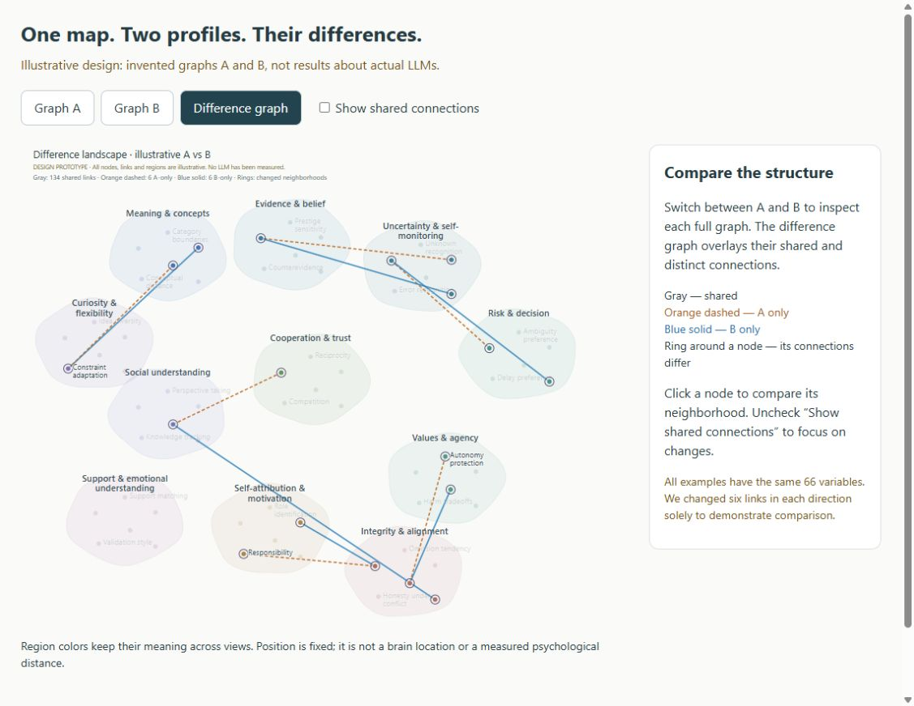

# LLM psychometric testing and knowledge-graph visualization

A research-informed exploratory battery and an independent offline viewer for comparing LLM response profiles. **Not a validated personality test or a clinical diagnostic instrument.**

## Start here: prompts and categories

**[Read the expanded questions, grouped by category](battery_full/PROMPTS.md)** · **[CSV](battery_full/prompts.csv)** · **[Run and analyze them](battery_full/README.md)**

**[Open the A100 Colab notebook](https://colab.research.google.com/github/dwtrott/llm_psychometric_test/blob/main/battery_core/Run_HuggingFace_A100.ipynb)** to download a Hugging Face model, run the full battery, and download responses, scores, graphs and reports. Defaults to Qwen2.5-7B-Instruct; the model is configurable. No paid model API is used.

The notebook now defaults to the **scored v0.10 battery: 240 base cards / 280 stages**, presented in four menu rounds by default (**960 conversations / 1,120 stages**), across all 11 categories and 22 facets. It includes distinct scenario contexts, two task-instruction wordings, and 120 development plus 120 matched held-out cards. Scenario facts, incentives, response fields and scoring remain fixed across wording pairs. All questions are text-only. Completion is reported by facet, partition and wording; rejected responses and missing stages are explicit.

**Scoring is now part of the Colab run.** The formerly text-only facets have explicit response menus alongside bounded written answers. Fixed-rule measurements score selections and quantities. A separate local rubric pass scores written content with exact supporting quotations and saved judge provenance. These provisional model judgments are distinguished from human ratings and deterministic consistency checks. See the [choice-to-tendency scoring key](battery_full/SCORING.md). Scores follow canonical option meanings across permuted response codes; scenario-balanced tendency estimates enter the KG. Open `results/measurements.html` to see the actual scores and evidence. The notebook rejects stale adapters and verifies the full instrument before loading model weights.

Results include separate development and held-out graphs for the existing analyzer and viewer. Capability controls remain separate from behavioral features, and open-response content still requires review. This is an exploratory instrument, not a validated full psychological fingerprint. The [design guide](battery_full/README.md) explains near-transfer limits, fixed option order and why repeated wordings are not independent scenarios. The [50-card compact release](battery_core/PROMPTS.md) remains available for earlier-run reproducibility.

## Earlier v0.7: actual questions and measurement gaps

**[Read verbatim v0.7 questions from all 14 task families](battery_v7/ACTUAL_QUESTIONS.md)**, including both conditions, follow-up stages, response requirements and optional resource contents. Read the accompanying **[content and scoring audit](battery_v7/CONTENT_AUDIT.md)** before interpreting results.

The earlier v0.7 instrument contains custom text tasks, not a demonstrated full psychological fingerprint. Its 1,224 sessions expand 84 scenario forms through presentation and condition changes; some held-out forms are close context substitutions. The audit records the scoring gaps at that release. A subsequent content-rating importer now supports agreed ordinal ratings; the compact core documents that workflow. The network atlas below uses 66 illustrative variables and invented links, not 66 dimensions measured by a battery. No real-model validation is supplied by the demos.

## New: psychological network atlas and difference view

The [network atlas guide](network_atlas/README.md) explains the connected-landscape visualizer, with screenshots, a single-graph walkthrough, comparison controls and interpretation rules. It organizes many smaller behavioral-pattern nodes into soft psychological regions, with connections crossing their boundaries.

**This is a design prototype using invented graphs, not measured LLM psychology.** It has Graph A, Graph B and Difference graph views on the same layout. Gray links are shared, orange dashed links occur only in A, and blue links occur only in B. Click a node to inspect its neighborhood, or hide shared connections to isolate the differences.



Download/extract the repository and open [`network_atlas/network-comparison.html`](network_atlas/network-comparison.html) in your browser. GitHub shows HTML source rather than running it. The prototype works offline, uses Python standard-library generators and native HTML/CSS, and has no JavaScript or external assets. It does **not yet import real response graphs**. See the guide for the [single-network screenshot and interpretation table](network_atlas/README.md#how-to-read-the-visualizer), local-server/Colab instructions, and the distinction between illustrative connections and evidence-supported relationships.

## Analyze actual battery outputs

**Analyze v0.7 results:** use the [Python analysis and visualization tool](analyzer/README.md), with a [Colab notebook](analyzer/Psychometric_Analysis.ipynb). It shows available task features, evidence coverage, wording/order/presentation effects, matched model differences, and elicited concept associations. Its transfer-variant comparison does not score conceptual transfer performance. These are partial response profiles, not a measured full psychology. The battery questions remain frozen.

## Read the questions first

**Latest: [v0.7 balanced presentations](battery_v7/README.md)** — fixes duplicate paraphrases and explicitly counterbalances substantive choice order and conceptual transfer patterns across all 14 profile facets. Includes full rendered questions, presentation-aware Python scoring and side-by-side comparisons. Capability controls remain separate; larger presentation counts do not mean more independent psychological scenarios.

**Latest: [v0.6 structure-matched revision](battery_v6/README.md)** — redesigns the eight confounded pairs from the v0.5 review, fixes meaning-changing paraphrases and retains all 14 candidate profile facets with separate capability controls. Includes complete CSV/questions, Python scoring and a four-column evaluator comparison. Empirical psychological equivalence remains unverified.

**Latest: [v0.5 matched-context revision](battery_v5/README.md)** — repairs paraphrases, separates capability controls, and pairs development and held-out contexts while preserving stated operations and incentives. Includes role/advice strata in Python scoring and graph evidence. Matching empirical difficulty and psychological validity remain unverified.

**New: [v0.4 scenario-based core](battery_v4/README.md)** — 16 candidate facets across all 12 regions, with four development and two held-out scenario forms per facet, two paraphrases and matched conditions. Includes complete questions, a fixed split manifest, Python scoring that distinguishes repetitions from scenarios, and a held-out analysis-lock workflow. This is a research draft, not a claim that stable psychological fingerprints have already been established.

**Running it later? Start with the [v0.3 Colab guide](battery_v3/COLAB_GUIDE.md)** for setup, recording model responses, scoring, and opening one or two profiles in the KG visualizer.

**Earlier broad battery: [v0.3 full-profile question book](battery_v3/README.md)** — retained as supplementary coverage and for reproducibility. Its 39 task families include facets not yet included in the repeated-scenario core. Read the [48-family revision map](battery_v3/REVISION_MAP.md) and [scoring protocol](battery_v3/PROTOCOL.md). Do not pool instrument versions.

The [v0.2 question book](battery_v2/README.md) and v0.1 content below are retained for reproducibility. The quick-start farther below is the legacy v0.1 interface; v0.3 and v0.4 have their own staged-run instructions.

**[Open the complete question book](battery/QUESTIONS.md)** to read every scenario, question, answer choice and response instruction, organized into 28 module pages. No code needs to be run. [Complete prompts in CSV](battery/complete_prompts.csv) are also included, with the full user prompt in one column.

The legacy v0.1 bank has 436 instantiated items, including condition variants of simple association, reasoning and fictional decision tasks. They are a pilot sampling of response patterns, **not a complete psychological profile**, nor 436 independent validated psychological questions. Research references explain the background; they are not pointers to missing question content. Making these prompts readable does not resolve limitations in task depth, ambiguity, coverage or validation.

## Components

- [`battery_full/`](battery_full/README.md): expanded default, 240 cards / 280 stages, scenario and wording comparisons plus prespecified held-out transfer.
- [`battery_core/`](battery_core/README.md): compact prompt list and CSV, 50 cards / 22 facets / 11 categories, standard-library runner, reviewed-content workflow and existing-harness compatibility.
- [`network_atlas/`](network_atlas/README.md): connected-network design prototype, single/difference views, Python generators, illustrative data, and screenshot/interpretation guide.
- [`analyzer/`](analyzer/README.md): response-based v0.7 analysis, findings/evidence KG exports, matched comparisons and a Colab notebook; separate from the illustrative atlas.
- [`battery/`](battery/README.txt): 436 CSV questions across 28 modules, Python preparation/scoring, configuration templates, research sources, and graph export.
- [`battery_v2/`](battery_v2/README.md): revised full-profile scenarios, controlled contrasts and review rubrics; separate versioned processor.
- [`battery_v3/`](battery_v3/README.md): broader supplementary tasks, separate controls, staged interaction runner, raw transcripts and evidence-graph export.
- [`battery_v4/`](battery_v4/README.md): repeated-scenario core, paraphrases, held-out partitions, analysis locks and design-aware Python scoring.
- [`viewer/`](viewer/README.txt): self-contained HTML viewer, Python embedding helper, Colab notebook, and explicitly synthetic demonstrations.
- [`viewer/src/`](viewer/src/): editable JavaScript and HTML/CSS source.
- [`tests/`](tests/): 17 battery checks and 20 viewer checks.

Coverage includes conceptual associations, learning/reasoning, evidence/confidence, risk/time preferences, social understanding, values, self-evaluation, and integrity/alignment under conflict. Deception and Dark Triad-inspired behavioral probes form one component, not the entire profile. No global personality or alignment score is calculated.

## Quick start

Requires Python 3.10+ (standard library only). Open `viewer/demo.html` in a browser to explore two **synthetic profiles**, or open `viewer/viewer.html` and load processor `graph.json` exports. No CDN or server is required.

```sh
cd battery
# Edit config.example.json with the actual model configuration first.
python processor.py prepare --config config.example.json --run-id modelA-session1 --repeats 4 --out ../runs/modelA
# Collect model outputs using your own API adapter, then:
python processor.py process --plan ../runs/modelA/plan.json --responses ../runs/modelA/responses.csv --out ../results/modelA
cd ..
python viewer/viewer.py results/modelA/graph.json --out results/modelA/viewer.html
```

The processor prepares prompts and scores collected responses; it does **not** call a model API. Never send scoring keys, construct labels or the full plan to the tested model. See the battery guide for response formats and counterbalancing.

## Graph comparison in the legacy viewer

Select two profiles and open **Graph comparison**. A, B and difference panels share node positions, pan/zoom and selection. Gray indicates differences within a descriptive tolerance, teal stronger in A, orange stronger in B. Dashed links indicate one-sided observations; missing links are not zeros. Inspect a concept for the supporting trials.

This paragraph describes `viewer/`, not the new `network_atlas/` prototype. Their legends differ: the atlas currently compares unweighted edge presence, not relationship strength. Use the legend and interpretation guide for the component you are viewing.

Comparisons require the same battery hash. Scores are matched by item and condition; generation settings and missingness can confound differences. Semantic regions are exploratory and researcher-defined domains are organizing hypotheses, not validated latent traits.

## Colab

Upload [`viewer/Psychometric_KG_Viewer.ipynb`](viewer/Psychometric_KG_Viewer.ipynb) to Colab and run its cells. It contains the complete viewer and embedding helper; upload processor graph exports when prompted. Colab uploads are handled in your cloud session. The downloaded HTML works offline. Live Colab execution has not been verified.

## Development and validation

```sh
python scripts/build_viewer.py
python scripts/export_question_book.py
python scripts/build_battery_v2.py
python tests/test_battery.py
python tests/test_battery_v2.py
node tests/test_viewer.js
python -m http.server 8767 --bind 127.0.0.1 --directory viewer
```

Then visit http://127.0.0.1:8767/demo.html. Node is needed only for JavaScript tests. The build refreshes HTML, embedded demos and notebook from source. Browser checks confirmed shared positions, synchronized pan/zoom, linked selection, difference colors, tolerance controls and rating-layer switching. A horizontal-overflow issue found during testing was fixed. Demo outputs are synthetic; no real-model validation is claimed.

Research references, scoring rules and evidence limitations are included alongside each component. All imported raw prompts/responses are included when saving a portable viewer; do not commit private runs or credentials.

The v0.2 graph embeds its own region/family catalog. Its open responses remain pending independent review, not silently zero-scored. No actual LLM results are included in this revision.
