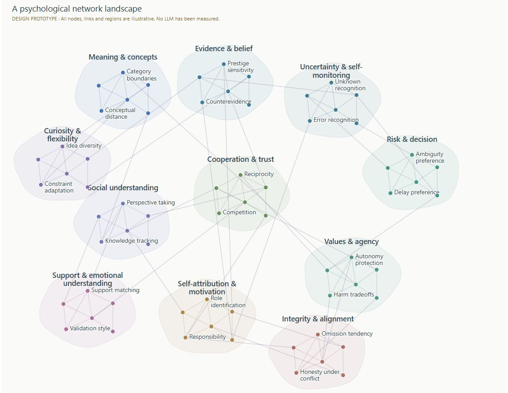
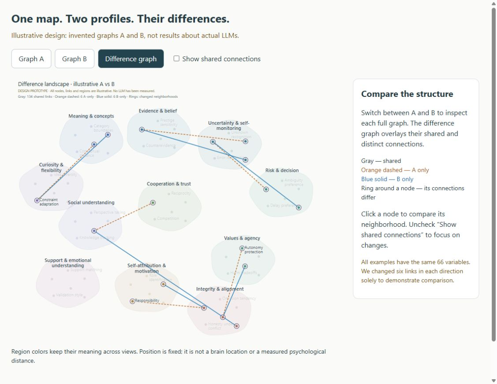

# Psychological network atlas: single graphs and differences

This prototype presents a psychological profile as a connected landscape: specific behavioral-pattern nodes form neighborhoods inside soft psychological regions, with links crossing between regions. It supports exploring one network and comparing two networks without changing the map's layout.

**Current status: an interactive design prototype with invented data.** The 66 variables, 11 regions and all connections are illustrative. They are not extracted from LLM responses, not validated psychological constructs, and not a one-to-one expansion of the current battery. There is no model API call, real-graph upload, statistical estimation or personality scoring in this component yet. For processing actual v0.7 exports, use the separate [response-based analyzer](../analyzer/README.md).

## See the representation

### One psychological landscape



The graph is the main object. Regions organize the view, while the smaller nodes represent candidate patterns such as information seeking, uncertainty tolerance, audience sensitivity and credit attribution. Clicking a dot highlights its neighborhood and lists its connections. Node labels are selective to keep the overview readable; every dot can be inspected.

### Difference landscape



This screenshot has **Show shared connections** unchecked. The same regions and node positions remain visible while the changed connections stand out. The ringed nodes have different neighborhoods in the two illustrative graphs.

The screenshots are actual browser captures of this prototype. They do not depict empirical LLM findings.

## Open it

Download the repository ZIP from GitHub and extract it, or clone the repository. Then open **[network-comparison.html](network-comparison.html)** in a modern browser. It includes Graph A, Graph B and Difference graph views. The simpler [network-concept.html](network-concept.html) explores the original single-network design.

GitHub displays HTML source rather than running the application. Download/extract the files to use the controls. You can view the standalone illustrations directly: [Graph A](comparison-a.svg), [Graph B](comparison-b.svg), [difference graph](comparison-difference.svg), and [original landscape](network-concept.svg).

The HTML is self-contained and works offline: no external assets, JavaScript, CDN, server, API key or package installation. Native HTML controls and CSS handle view switching, selection and filtering. Keep the output folder together if you want the SVG and JSON download links to work. On narrow screens, the graph scrolls horizontally to preserve label readability.

If local file access is inconvenient, run this from the repository root:

```sh
python -m http.server 8000 --bind 127.0.0.1 --directory network_atlas
```

Then [open the comparison locally](http://127.0.0.1:8000/network-comparison.html).

## A short walkthrough

1. Choose **Graph A**. Click a node to inspect its neighboring patterns. The selected neighborhood stays prominent and unrelated nodes/links fade.
2. Choose **Graph B**. The node positions and region boundaries stay fixed. Only the example network's connections change. If a node is selected, its details update for the active graph.
3. Choose **Difference graph**. Shared, A-only and B-only connections are displayed together. Clicking a node separates its neighbors into those three groups.
4. Uncheck **Show shared connections** to focus on changes. Unchanged nodes fade; their regions remain as context. Recheck it to see similarities again.
5. Click **Show whole graph** to clear the selected neighborhood. This preserves the chosen graph and shared-connection filter.

For a concrete example, click **Evidence seeking**. In the invented comparison it connects to **Verification** only in A and to **Uncertainty tolerance** only in B. It shares connections to Source trust, Alternative search, Prestige sensitivity and Counterevidence. This illustrates a structural difference; it is not a finding about any actual model.

## How to read the visualizer

| Element | Meaning here | What it does not establish |
| --- | --- | --- |
| Soft colored region | A proposed area for navigating related candidate variables | A discovered psychological community, validated factor or anatomical brain area |
| Small node | One named candidate behavioral pattern | A neuron, measured trait score, or quantity of that trait |
| Node color | Proposed region membership | Better/worse behavior or a model score |
| Connection in A or B | An invented relationship used to demonstrate the interface | Correlation, causation, psychological mechanism or empirical support |
| Gray connection in the difference view | The same edge is included in both example graphs | Psychological equivalence of the models |
| Orange dashed connection | Present in illustrative A, absent from illustrative B | An increase/decrease in strength or a favorable/unfavorable result |
| Blue solid connection | Present in illustrative B, absent from illustrative A | Proof that a real model possesses a relationship another lacks |
| Ring around a node | At least one connection differs between A and B | A difference in that node's behavioral value or trait intensity |
| Faded nodes/links after selection | Outside the selected node's immediate neighborhood | Missing data or weak effects |
| Faded unchanged nodes with shared links hidden | Context retained while focusing on changed neighborhoods | Statistically insignificant patterns |
| Physical distance, central placement or region size | Illustrative layout choices | Psychological distance, centrality, importance or brain structure |
| Line thickness | Display/selection emphasis | Estimated relationship strength |

All three views reuse the same coordinates. This avoids making a layout rearrangement look like a psychological difference. There is no synchronized pan/zoom implementation; selection, graph switching and shared-link filtering are the current interactions.

## What the example actually contains

- 66 common nodes, arranged into 11 proposed regions.
- 140 unweighted, undirected links in A and 140 in B.
- 134 shared links, six A-only links and six B-only links.
- Every relationship is tagged `illustrative_only`, with `weight: null`.

The code deliberately substitutes six connections to demonstrate the difference view. Counts and topology are not statistics from a battery run. The regional color palette and exact six substitutions are design choices.

## What is needed for real model comparisons

The eventual fingerprint should distinguish **node behavior**, **relationships between behaviors**, and **evidence quality**. This prototype only demonstrates unweighted connection differences. It does not yet load the analyzer's `knowledge_graph.json` or battery `graph.json` exports.

A real-data adapter and estimator must:

1. Map the same operationally defined variables across models, with matched contexts, coding rules and model configurations.
2. Keep observed semantic relations, statistical associations, and untested hypotheses as different edge types. Do not merge them into one undifferentiated network.
3. Preserve unmeasured, uncertain and excluded evidence. An absent edge in an incomplete export is not automatically a measured zero or a model-specific absence.
4. Estimate edge strength and uncertainty from appropriate jointly measured observations; unrelated scenario IDs, paraphrases and repeats are not independent paired observations.
5. Compare node values and connection strengths on compatible evidence, then validate reproducibility and held-out prediction before calling the result a stable psychological fingerprint.

The graph's geography is a navigation metaphor. It is not a scan of an LLM's internal representations, and making a network denser does not make it more psychologically valid.

## Python sources and regeneration

Python 3.10+ and the standard library are sufficient. Run from the repository root:

```sh
python network_atlas/build.py
python network_atlas/compare.py
```

| File | Purpose |
| --- | --- |
| [build.py](build.py) | Defines the illustrative nodes, regions and original links; generates the single-network HTML, SVG and JSON |
| [compare.py](compare.py) | Creates A/B substitutions, computes set differences, and generates the comparison interface and SVGs |
| [network-comparison.html](network-comparison.html) | Portable single/difference viewer |
| [network-comparison.json](network-comparison.json) | Invented A/B graph data, shared/distinct edge sets and changed neighborhoods |
| [network-concept.html](network-concept.html) | Original single-network concept |
| [screenshots/](screenshots/) | Browser screenshots used in this guide |

The builders write beside their source files. They regenerate the HTML/SVG/JSON, not the screenshots. They do not modify the battery, score responses, or call models.

### Colab

Clone the repository if it is not already in your session, then generate and download the folder:

```python
!git clone --depth 1 https://github.com/dwtrott/llm_psychometric_test.git
%cd llm_psychometric_test
!python network_atlas/build.py
!python network_atlas/compare.py

import shutil
from google.colab import files
archive = shutil.make_archive("network-atlas", "zip", "network_atlas")
files.download(archive)
```

Extract the downloaded ZIP and open `network-comparison.html`. If the repository is already cloned, skip the clone step and use its existing directory. Colab's upload/download helpers are built in; the generators use only standard-library Python. Live Colab execution of this prototype has not been verified.

## Verification and research background

Browser checks verified A/B switching, neighborhood inspection, the shared-link filter and identical coordinates for all 66 nodes across the three views. Filtering shared links leaves 12 distinct links. Regeneration and graph/HTML/SVG integrity are checked with:

```sh
python -m unittest discover -s tests -p test_network_atlas.py
```

The representation borrows from network psychometrics, where variables are represented as nodes and their relationships as edges. Network layout itself can be misleading: visual proximity is not necessarily association strength, and a central-looking node need not be statistically central. See [Jones, Mair & McNally, *Visualizing Psychological Networks*](https://www.frontiersin.org/journals/psychology/articles/10.3389/fpsyg.2018.01742/full).

Human between-person and within-person networks also answer different questions; a population-level relationship cannot simply be treated as one LLM's organization. See [Costantini et al., *Stability and variability of personality networks*](https://doi.org/10.1016/j.paid.2017.06.011). These sources inform the design; they do not validate this prototype's proposed variables, region assignments or invented links.
